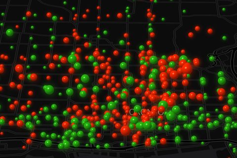

# Pulse: Toronto Bike Share, hour by hour

By [Blair Zasitko](https://blairz.ca)

**See it live: https://blairz.ca/pulse/**

Every sphere is a Bike Share Toronto station. Its size is how fast the station's bike count
is changing at that hour, and its colour is which way: red stations are losing bikes, green
ones are gaining them. All 7.3 million trips of 2025 are folded into one typical Monday to
Sunday, so you can watch downtown fill up every weekday morning and drain back out every
evening.

## How it works

Nothing is queried while it plays. `tools/aggregate.py` reads the City's ridership files once
and writes compact binary files, 1.9 MB for the whole year: the flow in and out of every
station for every hour of the week, at three levels of detail. The page downloads those and
the GPU draws each station as a shaded sphere over a MapLibre map. There is no server-side
code, so any static host will serve it.

- `?year=2026` shows January to March 2026, which is as much of 2026 as the City has
  published so far.
- `?reel=1` is the vertical version made for short videos. `tools/render_video.mjs` renders
  it frame by frame to a 1080 × 1920 MP4.

The controls are from [glass-ui-kit](https://github.com/datumsOG/glass-ui-kit): real refractive glass, drawn by
one shader over the finished map.

## How it was made

I designed Pulse and directed its construction with AI coding agents (Claude), and checked
what they built against the data. Any claim the video makes, such as downtown filling up in
the morning, was checked against the numbers before it went in.

## Data and credits

- Ridership: [Bike Share Toronto Ridership Data](https://open.toronto.ca/dataset/bike-share-toronto-ridership-data/),
  City of Toronto Open Data, used under the
  [Open Government Licence – Toronto](https://open.toronto.ca/open-data-license/).
- Station locations: the Bike Share Toronto public GBFS feed.
- Map: [OpenFreeMap](https://openfreemap.org/), © [OpenStreetMap](https://www.openstreetmap.org/copyright) contributors.

The code is MIT-licensed (see `LICENSE`). The data stays under its own licence.
